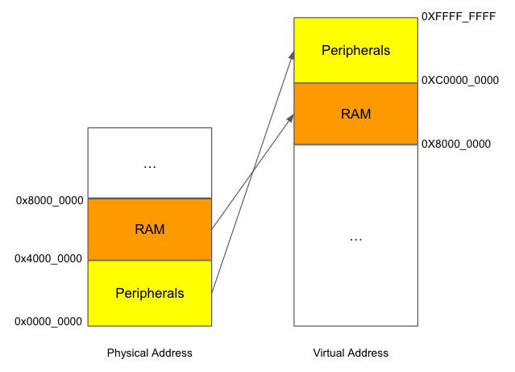
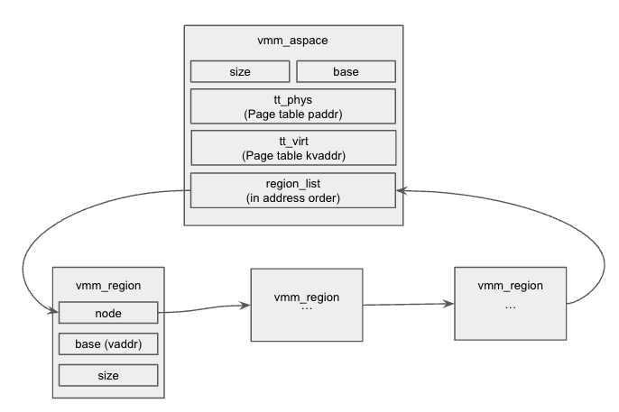
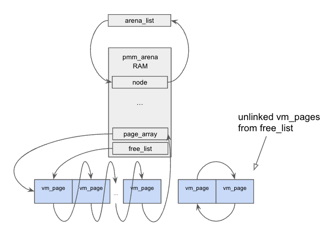
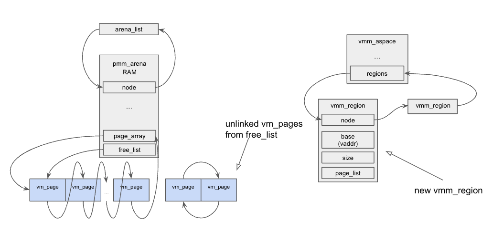
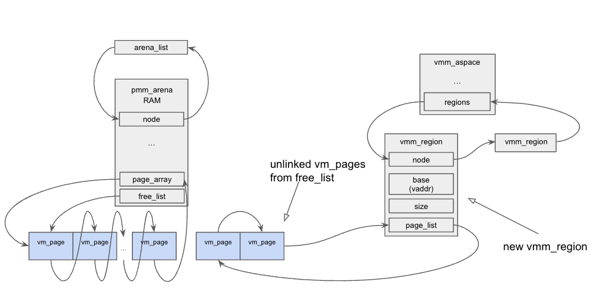

# LK Memory Management Overview

# Abstract

This article discusses the memory management system of the LK OS.

First, we look at the initial memory mapping and allocator without VMM, and see how LK use them to sets up the virtual memory system.

Then, the article explains the data structures LK uses to manage physical pages and virtual addresses.

At the end, we show how LK uses these structures for page mapping.

# Initial mapping

Upon reset, LK does the initial mapping described by the global array `mmu_initial_mappings`. On arm32 and arm64 the boot code walks that table: [arch/arm/arm/start.S](https://github.com/littlekernel/lk/blob/b2a9846ceb89703bee598db05b222ac19b7cbde9/arch/arm/arm/start.S#L133) and [arch/arm64/start.S](https://github.com/littlekernel/lk/blob/b2a9846ceb89703bee598db05b222ac19b7cbde9/arch/arm64/start.S#L87). riscv, x86 and m68k build a fixed physmap in their boot code and describe it in the same table (for example in `arch/riscv/mmu.cpp`).

The `mmu_initial_mappings` layout depends on the platform. This article uses qemu-virt-arm built for 32-bit arm (`qemu-virt-arm32-test`) as its example; the table is in [platform/qemu-virt-arm/platform.c](https://github.com/littlekernel/lk/blob/b2a9846ceb89703bee598db05b222ac19b7cbde9/platform/qemu-virt-arm/platform.c#L43). The platform builds for arm64 by default, with a different layout. The following demonstrate the 32-bit layout.



Initial Memory Mapping

In LK, the term 'paddr' is used for referring physical memory addresses. After this initial mapping, the virtual addresses are referred to as 'kvaddr'. A physical address covered by an initial mapping that is not marked temporary has one 'kvaddr', and the function 'paddr_to_kvaddr' carries out this translation; it returns NULL for any other physical address. The first entry is the physmap on nearly every platform, so the inline checks it before searching the rest of the table.

```c
// kernel/include/kernel/vm.h
static inline void *paddr_to_kvaddr(paddr_t pa) {
    const struct mmu_initial_mapping *map = &mmu_initial_mappings[0];
    if (!(map->flags & MMU_INITIAL_MAPPING_TEMPORARY) && pa - map->phys < map->size) {
        return (void *)(map->virt + (pa - map->phys));
    }
    return paddr_to_kvaddr_search(pa);
}

// kernel/vm/vm.c
void *paddr_to_kvaddr_search(paddr_t pa) {
    const struct mmu_initial_mapping *map = mmu_initial_mappings;
    while (map->size > 0) {
        if (!(map->flags & MMU_INITIAL_MAPPING_TEMPORARY) &&
                pa >= map->phys &&
                pa <= map->phys + map->size - 1) {
            return (void *)(map->virt + (pa - map->phys));
        }
        map++;
    }
    return NULL;
}
```

LK also uses the term 'vaddr'. This stands for the virtual address that is mapped by the virtual memory management — the real deal VMM. 'vaddr' is very flexible - the address could either be in the kernel space or the user space. The address can also change its mapping to different physical memories as needed. 'kvaddr' is always a 'vaddr', but it's important to note that not all 'vaddr' are 'kvaddr'. We'll go into more detail on this as we delve deeper into memory management.

# Boot allocator

QEMU places the device tree at the base of RAM, below an ELF kernel, so qemu-virt-arm sets `KERNEL_LOAD_OFFSET` to 1MB and the kernel is linked just above it.

After initial mapping, but before the memory management gets set up, LK uses a boot allocator to allocate memory from the RAM. This allocator is simple and has two pointers - "boot_alloc_start" and "boot_alloc_end". Both pointers point to the end of the LK kernel image at the beginning. When more memory is needed, the allocator returns the value of "boot_alloc_end" and moves it forward. The value of "boot_alloc_start" stays the same.

```
virtual address
0xFFFF_FFFF  +----------------------+
             |     peripherals      |
0xC000_0000  +----------------------+  end of the 1GB RAM mapping
             |                      |
             |     free memory      |
             |                      |
             +----------------------+  <- boot_alloc_end, moves up on each allocation
             |   boot allocations   |
             +----------------------+  <- boot_alloc_start = _end
             |   LK kernel image    |
0x8010_0000  +----------------------+  <- _start = KERNEL_BASE + KERNEL_LOAD_OFFSET
             | device tree, then    |
             | free pages           |
0x8000_0000  +----------------------+  <- KERNEL_BASE, start of RAM
             |         ...          |
```

LK kernel and boot allocator

The related code can be found at [kernel/vm/bootalloc.c](https://github.com/littlekernel/lk/blob/b2a9846ceb89703bee598db05b222ac19b7cbde9/kernel/vm/bootalloc.c#L22)

```c
extern int _end;
uintptr_t boot_alloc_start = (uintptr_t) &_end;
uintptr_t boot_alloc_end = (uintptr_t) &_end;
void *boot_alloc_mem(size_t len) {
    ...
    ptr = ALIGN(boot_alloc_end, 8);
    boot_alloc_end = (ptr + ALIGN(len, 8));
    ...
    return (void *)ptr;
}
```

“_end” is a link script variable that points to the end of the kernel image, bss included. The link script is [arch/arm/system-onesegment.ld](https://github.com/littlekernel/lk/blob/b2a9846ceb89703bee598db05b222ac19b7cbde9/arch/arm/system-onesegment.ld#L111)

```c
ENTRY(_start)
SECTIONS
{
    . = %KERNEL_BASE% + %KERNEL_LOAD_OFFSET%;
    _start = .;
    ...
    _end = .;
}
```

“KERNEL_BASE” defaults to 0x8000_0000 and “KERNEL_LOAD_OFFSET” to 0 in the arm rules; qemu-virt-arm sets the offset to 1MB.

```make
# arch/arm/rules.mk
KERNEL_BASE ?= 0x80000000
KERNEL_LOAD_OFFSET ?= 0

# platform/qemu-virt-arm/rules.mk
KERNEL_LOAD_OFFSET := 0x100000 # 1MB
```

# Physical Memory (pmm_arena)

With the initial mapping and boot allocator in place, the platform code sets up the structures that manage physical memory.

LK uses a structure named 'pmm_arena' for a contiguous chunk of physical memory. It holds the arena's name, its base (a paddr) and size, a count of free pages, a priority, and flags; `PMM_ARENA_FLAG_KMAP` marks an arena that lies in the kernel's initial mapping, so its pages have a 'kvaddr' (check the Initial Mapping section if you need to remember what these mean). All 'pmm_arena' structures are on one global list, 'arena_list' in kernel/vm/pmm.c, sorted by priority with the lowest first; allocations walk the arenas in that order.

In LK, memory is managed at the page’s granularity. A page is 4KB here; arm64 can also be built with 16KB or 64KB pages (`qemu-virt-arm64-16k-test`, `qemu-virt-arm64-64k-test`). The 'pmm_arena' structure includes a pointer, 'page_array', to a 'vm_page' array. Each element in the array corresponds to one page in the 'pmm_arena': element i describes the page at base + i * PAGE_SIZE.

Once a 'pmm_arena' is added, all of its 'vm_page' items are linked to its 'free_list'. This means the Virtual Memory Manager (VMM) hasn't allocated these pages yet. We'll go deeper into the VMM and this field later on.

```
arena_list --> pmm_arena "fdt" --> next arena, in priority order
                 |- node            link on arena_list
                 |- name, flags, priority
                 |- base            paddr of the arena's first page
                 |- size
                 |- free_count
                 |- page_array --> [ vm_page 0 | vm_page 1 | ... | vm_page n ]
                 `- free_list  --> vm_page 0 <-> vm_page 1 <-> ... <-> vm_page n
                                   (the same vm_pages, linked through vm_page.node)
```

pmm_arena

On qemu-virt-arm, `platform_early_init()` adds the arenas by calling `fdtwalk_setup_memory()` ([lib/fdtwalk/helpers.cpp](https://github.com/littlekernel/lk/blob/b2a9846ceb89703bee598db05b222ac19b7cbde9/lib/fdtwalk/helpers.cpp#L74)), with the MMU already on. The function:

- reads the memory banks from the device tree, falling back to the base and size the platform passes in when it finds none;
- on 32-bit arm and riscv32, keeps only the first 1GB above `MEMBASE`, which is what the initial mapping covers;
- adds one arena per bank with `pmm_add_arena()`, each named "fdt" and flagged `PMM_ARENA_FLAG_KMAP`, from a static array of eight;
- takes the device tree's `/reserved-memory` ranges, and the pages holding the device tree itself, out of the free lists with `pmm_alloc_range()`.

QEMU describes a single memory bank, so qemu-virt-arm ends up with one arena.

```c
// platform/qemu-virt-arm/platform.c
void platform_early_init(void) {
    ...
    // detect physical memory layout from the device tree
    fdtwalk_setup_memory(fdt, MEMORY_BASE_PHYS, MEMORY_BASE_PHYS, DEFAULT_MEMORY_SIZE);
    ...
}
```

Here's one thing we should note. After an arena is added, all of its pages are linked to the 'free_list'. However, not all of them are really free. fdtwalk_setup_memory() takes out the device tree, but the kernel image and the boot allocator's memory, which includes each arena's 'page_array', are still on the list. LK takes them out in 'vm_init_preheap()', after the VMM has set up the kernel aspace and before the heap is initialized.

```c
// kernel/vm/vm.c
static void vm_init_preheap(uint level) {
    vmm_init_preheap();  // <-- set up the kernel aspace

    // Remove the kernel image's RAM from free_list
    mark_pages_in_use((vaddr_t)&_start, ((uintptr_t)&_end - (uintptr_t)&_start));

    // Remove the RAM allocated via boot allocator from free_list
    if (boot_alloc_end != boot_alloc_start) {
        mark_pages_in_use(boot_alloc_start, boot_alloc_end - boot_alloc_start);
    }
}
```

# Virtual Address (aspace)

In LK, as in many systems, a thread running user code sees two separate virtual address ranges. One is the kernel address space, shared by every thread; the kernel runs in it while it handles an exception or system call from user code. The other is the user address space of the thread's 'aspace', which only threads in that aspace see. All of the memory management structures are managed in the kernel address space. The initial mapping we talked about earlier is also in the kernel address space.

For `qemu-virt-arm32-test` the split is:

| Virtual range | Size | Use |
|---|---|---|
| `0x0000_0000`–`0x00FF_FFFF` | 16MB | guard, never mapped |
| `0x0100_0000`–`0x3EFF_FFFF` | 992MB | user space, one per user aspace |
| `0x3F00_0000`–`0x3FFF_FFFF` | 16MB | guard, never mapped |
| `0x4000_0000`–`0xFFFF_FFFF` | 3GB | kernel space, shared |

The kernel half of the address space is the same in every aspace, so kernel code runs the same regardless of which user aspace is loaded. Nothing stops the kernel from touching user addresses while a user aspace is active: none of the arches enable the protections that would (SMAP on x86, PAN on arm64, clearing SUM on riscv), which the arch tests rely on to read user pages directly.

The ranges for both the kernel and user address spaces are defined at:

```c
// arch/arm/rules.mk
...
KERNEL_ASPACE_BASE=0x40000000
KERNEL_ASPACE_SIZE=0xc0000000

// kernel/include/kernel/vm.h
...
#ifndef USER_ASPACE_BASE
#define USER_ASPACE_BASE ((vaddr_t)0x01000000UL)
#endif
#ifndef USER_ASPACE_SIZE
#define USER_ASPACE_SIZE ((vaddr_t)KERNEL_ASPACE_BASE - USER_ASPACE_BASE - 0x01000000UL)
#endif
```

LK uses a structure known as 'vmm_aspace' to represent an address space. There's one globally shared 'vmm_aspace' that describes the kernel space (`vmm_get_kernel_aspace()`), and each user address space is a 'vmm_aspace' of its own, made with `vmm_create_aspace()`. A thread runs in the one its `aspace` field points to.

The 'vmm_aspace' structure contains the base of the virtual address region (in our case, 0x0100_0000 for user space and 0x4000_0000 for kernel space), the size of the region, and an 'arch_aspace' member with the arch's own state, most importantly the 'paddr' and 'kvaddr' of the root page table: `tt_phys`/`tt_virt` on arm32 and arm64, `pt_phys`/`pt_virt` on riscv, `cr3_phys`/`cr3` on x86 and `pgtable_phys`/`pgtable_virt` on m68k. A user aspace's tables stay loaded while the kernel handles an exception or system call from it, and the kernel half is reached through them: arm32 and arm64 translate the two halves through separate registers (TTBR0 for the user half, TTBR1 for the kernel), and riscv and x86 copy the kernel's top level entries into every user root table.

'aspace' contains a region_list. The list tracks which parts of the virtual address space are reserved or already in use. Each used or reserved virtual address region is represented by a 'vmm_region' structure. This structure contains the region’s base address and how big it is. 'vmm_region' is ordered by the base address. These addresses are called 'vaddr' (remember we mentioned that 'vaddr' includes 'kvaddr' in the Initial Mapping section?).



vmm_aspace (tt_phys and tt_virt, the arm names, are in its arch_aspace member)

There's one more thing that is need mentioned. The kernel aspace range spans from 0x4000_0000 to 0xFFFF_FFFF. This range contains the initial virtual space layout created during initial mapping (0x8000_0000 to 0xC000_0000 for RAM, and 0xC000_0000 to 0xFFFF_FFFF for periperal). So LK needs to tell kernel aspace that these virtual spaces are already in used. This is accomplished by calling the function vmm_reserve_space after kernel aspace is initialized.

```c
// kernel/vm/vm.c
static void vm_init_postheap(uint level) {
    vmm_init();   // empty: the kernel aspace is set up in vmm_init_preheap()

    /* create vmm regions to cover what is already there from the initial mapping table */
    struct mmu_initial_mapping *map = mmu_initial_mappings;
    while (map->size > 0) {
        if (!(map->flags & MMU_INITIAL_MAPPING_TEMPORARY)) {
            vmm_reserve_space(vmm_get_kernel_aspace(), map->name, map->size, map->virt);
        }
        map++;
    }
}
```

In the function vmm_reserve_space, LK creates a vmm_region flagged `VMM_REGION_FLAG_RESERVED` and inserts it into region_list. It leaves the page tables alone: the mapping is already there, and the function only reads its flags with `arch_mmu_query()` to record them on the region.

# Arch MMU contract

`arch/include/arch/mmu.h` states one contract for `arch_mmu_map()`,
`arch_mmu_unmap()`, `arch_mmu_query()` and `arch_mmu_protect()` that every MMU
arch keeps. `arch_mmu_contract` in `arch/test/mmu_contract.cpp` checks it against
what the page tables hold afterwards, in a user aspace where the arch has them
and in a window of the kernel aspace everywhere. It does not read or write
through its mappings, so it cannot see whether a protect reached the TLB. In
short:

- Permissions are granted, not taken away: READ is required, WRITE and EXECUTE
  add to it. x86-32 and m68k have no NX, and x86-64 has it only when the cpu
  does; without it a page stays executable and query reports EXECUTE.
  `arch_mmu_supports_nx_mappings()` says which.
- Arguments are checked before anything else, a count of 0 included. A call
  returns `NO_ERROR` or a negative error, never a count, and one that fails
  leaves the mappings as they were.
- map refuses a page that is already mapped with `ERR_ALREADY_EXISTS`, and a
  page table allocation failure is `ERR_NO_MEMORY`; either way it takes back
  what it had mapped.
- unmap and protect skip holes, and refuse a range that covers part of a large
  page, or an entry the arch keeps fixed, with `ERR_NOT_SUPPORTED` before
  anything changes.
- protect replaces the R/W/X permissions and nothing else, refuses EXECUTE on
  uncached memory, and invalidates every page it changed, upgrades included.

map makes a large page wherever vaddr, paddr and count line up: arm64 2MB and
1GB blocks with 4K pages, 32MB with 16K and 512MB with 64K; riscv 2MB
megapages, and 1GB gigapages under sv48; arm32 1MB sections. x86 and m68k map
small pages only; x86's large pages are the physmap's, made at boot. Nothing
splits a large page, which is why taking part of one is refused.

# User address spaces

Each thread carries the user aspace it runs in (`thread_t::aspace`, NULL for a
kernel-only thread), and `vmm_set_active_aspace()` switches the current thread
to another one. When the scheduler switches between threads with different
aspaces it calls `vmm_context_switch(old, new)`, which hands both ends of the
switch to `arch_mmu_context_switch(old, new)`; `new == NULL` loads the
kernel-only state. On arm64 that means TTBR0 walks are disabled (TCR_EL1.EPD0),
which is also how every cpu boots, so a stray low address faults rather than
walking whatever TTBR0 holds. On riscv the kernel root table is loaded, whose
user half is empty.

## Paging mode on riscv

A riscv build picks its paging mode with `RISCV_MMU`, `sv39` or `sv48`, set by
the platform and overridable on the make command line. The mode fixes the table
depth, the aspace bases and sizes, and the physmap the boot code writes at the
bottom of the kernel half: 64 gigapages of 1GB under sv39, one 512GB terapage
under sv48. It is compiled in rather than probed; `start.S` reads satp back after
setting it and parks a hart at `riscv_mmu_mode_unsupported` if the cpu refused
the mode. 64-bit `qemu-virt-riscv` and the HiFive Premier P550 default to sv48;
jh7110 and spacemit-k1 use sv39, and the sifive-unleashed and qemu-sifive-u
targets run in supervisor mode without an MMU. The kernel half of every root
table is the same: the kernel's top level entries are written once at boot (the
physmap, and a static second level table behind every other kernel entry) and
copied into each user root as it is created, so `arch_mmu_map`,
`arch_mmu_unmap` and `arch_mmu_protect` never write a top level entry of the
kernel aspace, and an unmap or protect that would touch the physmap is refused.

## ASIDs

The arm64 and riscv ports tag user TLB entries with an address space identifier
so they survive a context switch. Both use the allocator in `kernel/vm/asid.c`:
the kernel is `ASID_KERNEL` (1), user aspaces are handed ids from 2 up, and an
aspace gives its id back when destroyed, after its entries have been flushed on
every cpu. The id is only used when the cpu implements the full width, 16 bits
on either arch (arm64 reports it in `ID_AA64MMFR0_EL1.ASIDBits` and enables it
with `TCR_EL1.AS`; riscv is probed by writing satp). Otherwise every user aspace
shares one id (2 on arm64; 0 on riscv, where the kernel runs on 0 as well) and
each switch to a different user aspace flushes that id on the local cpu.
`ARM64_ASID_FALLBACK=1` and `RISCV_ASID_FALLBACK=1` force the shared path for
testing, since qemu always implements 16 bits.

Kernel mappings are global on both arches (nG clear on arm64, the G bit on
riscv), so they match under any id and are invalidated with the all-asid forms;
user descriptors are marked non-global on arm64 so they are actually tagged.

## TLB maintenance

Every change to a translation table is made visible to the table walkers
before the invalidate that depends on it, and the invalidate is complete on
every cpu before anything relies on the old translation being gone: freeing a
page table, reusing an asid, or returning to the caller. On arm64 that is `dsb
ishst`, a broadcast `tlbi ...is`, then `dsb ish`, with an `isb` for kernel
mappings. riscv has no broadcast invalidate, so `sfence.vma` runs on every cpu
that translates through the kernel's tables, through `mp_sync_exec_cpus()`,
which requires interrupts to be enabled when other cpus are up. That set is not
the scheduler's active cpus: a secondary joins it just before it switches from
the boot trampoline to the kernel's tables, well before it is active, and a
shootdown in between waits until the secondary first enables interrupts.
riscv also fences after a map, since a cpu may cache a translation for a page
that was invalid when it last looked, unless the cpu advertises Svvptc, which
rules that out. Either way a page fault that the tables do not explain is taken
as such a stale translation: the hart flushes its TLB and retries the access,
and one that keeps recurring is reported as a real fault. Intermediate tables
emptied by an unmap are unlinked and freed only after the shootdown.
`arch_mmu_protect()` invalidates every page whose entry it changed, a permission
added as much as one taken away, since a cpu may still hold the old entry.

The other arches follow the same order. arm32 broadcasts its invalidates on SMP
and flushes a cpu's user entries on every switch between user aspaces, which all
run with ASID 0; x86 shoots down through `mp_sync_exec()`, also with interrupts
enabled; m68k flushes its ATC with `pflusha` after a map as well, since the
68040 caches a walk that ended at an invalid descriptor.

`arch_mmu_destroy_aspace()` expects every mapping to be gone already, which is
what frees the lower tables, and no cpu to have the aspace loaded.
`vmm_free_aspace()` switches the current thread off the aspace first. On arm64
and riscv it also fails with `ERR_BUSY` while another cpu still has the aspace
loaded: they keep that count in `arch_mmu_context_switch()` and report it
through `arch_aspace_active_cpus()`. x86, arm32 and m68k do not keep the count,
report 0, and so never refuse.

## Running in user mode

This covers arm64 and riscv. x86's `arch_enter_uspace()` panics as
unimplemented, and m68k has no user aspaces.

`arch_enter_uspace(entry, stack_top)` drops the current thread into user mode
in its active aspace; it never returns. Exceptions taken from user space reach
the kernel through weak hooks the arch provides: `arm64_syscall()` and
`arm64_user_exception()`, `riscv_syscall_handler()` and
`riscv_user_exception()`. The defaults print the frame and end the thread with
`thread_exit()` rather than panicking, and an override that wants the same
fallback can call the `*_unhandled()` variants. On arm64 the kernel keeps its
percpu pointer in x18, which user space may overwrite, so the vectors for
exceptions from EL0 reload it from a slot at the top of the thread's kernel
stack that `arch_enter_uspace()` fills and every return to EL0 refreshes.
`arch_uspace_tests` in `arch/test/` runs a stub through a syscall and a fault
this way on both arches, and a store and a jump into a page before and after
`arch_mmu_protect()` changes it.

# Physical to virtual mapping

Up to this point, we've discussed how LK manages physical memory (via the 'pmm_arena' structures) and how it manages virtual addresses (through the 'vmm_aspace' structures). However, these concepts become truly useful when we are able to map a physical memory to a virtual address. 

To allocate a chunk of memory that is accessible via virtual address space, the first step is to find enough unallocated physical pages. It can be done by searching pmm_arena’s free_list and unlink vm_page from the list. 



unlink vm_page from free_list

Notes that even though the 'vm_page's are unlinked from the 'pmm_arena's 'free_list', the 'pmm_arena' doesn’t lose the reference to the 'vm_page'. Because the 'vm_page's are part of the 'page_array', and the 'pmm_arena' still hold the pointer to 'page_array'.

In the picture above, the allocated 'vm_page's are consecutive. This isn't a requirement - it's just shown this way for simplicity. In practice, it's possible that the 'vm_page's are scattered around or even come from different 'pmm_arena's (although qemu-virt-arm only has one pmm_arena).

The pmm_alloc_pages function searches the free_list and unlinks the vm_page from it.

```c
// kernel/vm/pmm.c
size_t pmm_alloc_pages(uint count, struct list_node *list) {
    ...
    /* walk the arenas in order, allocating as many pages as we can from each */
    pmm_arena_t *a;
    list_for_every_entry(&arena_list, a, pmm_arena_t, node) {
        while (allocated < count && a->free_count > 0) {
            vm_page_t *page = list_remove_head_type(&a->free_list, vm_page_t, node);
            ...
            list_add_tail(list, &page->node);
            allocated++;
        }
    }
    ...
    return allocated;
}
```

Now that the physical pages are ready, the next step is to allocate a virtual address region to map them. As mentioned in the “Virtual Address (aspace)” section earlier, an address space is managed by a vmm_aspace. A allocated virtual address region is a vmm_region within vmm_aspace. Allocating a virtual address region involves searching through the vmm_aspace’s region_list, finding a large enough gap, creating a new vmm_region describing the gap, and inserting vmm_region into region_list.



new vmm_region

Please note that the vmm_region is sorted based on their base vaddr. In the illustration, the new vmm_region is depicted as the first element for clarity. However, in actual practice, the new vmm_region might not always be the first element. 

The process of finding a gap, creating a vmm_region, and inserting it into region_list can be accomplished using the alloc_region function.

```c
kernel/vm/vmm.c

static vmm_region_t *alloc_region(vmm_aspace_t *aspace, const char *name, size_t size,
                                  vaddr_t vaddr, uint8_t align_pow2,
                                  uint vmm_flags, uint region_flags, uint arch_mmu_flags) {
    // create vmm_region
    vmm_region_t *r = alloc_region_struct(name, vaddr, size, region_flags, arch_mmu_flags);
    ...
        // Find a gap in vmm_aspace
        struct list_node *before = NULL;
        vaddr = alloc_spot(aspace, size, align_pow2, arch_mmu_flags, &before);
        ...

        // Insert vmm_region into vmm_aspace.region_list
        r->base = (vaddr_t)vaddr;
        list_add_after(before, &r->node);
    }

    return r;
}
```

We now have the physical vm_pages and the vmm_region. The final step is to map the vm_page to the vmm_region. To achieve this, we must update the page table. The vmm_aspace's arch_aspace member points to the page table (as referenced in the “Virtual Address (aspace)” section above). In addition to updating the page table, LK will also link the vm_pages to the vmm_region’s page_list linked list. 

To handle all the aforementioned tasks, including allocating physical pages, setting up the virtual address region, and actual mapping, LK uses the vmm_alloc function.

```c
// kernel/vm/vmm.c
status_t vmm_alloc(vmm_aspace_t *aspace, const char *name, size_t size, void **ptr,
                   uint8_t align_pow2, uint vmm_flags, uint arch_mmu_flags) {
    ...
    // Allocate physical pages
    struct list_node page_list;
    list_initialize(&page_list);
    size_t count = pmm_alloc_pages(size / PAGE_SIZE, &page_list);
    ...
    // Allocate virtual address region
    vmm_region_t *r = alloc_region(aspace, name, size, vaddr, align_pow2, vmm_flags,
                                   VMM_REGION_FLAG_PHYSICAL, arch_mmu_flags);
    ...
    // 1. Link vm_page to vmm_region.page_list
    // 2. Update page table
    vm_page_t *p;
    vaddr_t va = r->base;
    while ((p = list_remove_head_type(&page_list, vm_page_t, node))) {
        paddr_t pa = vm_page_to_paddr(p);
        // Update page table
        err = arch_mmu_map(&aspace->arch_aspace, va, pa, 1, arch_mmu_flags);
        // Link vm_page to vmm_region.page_list
        list_add_tail(&r->page_list, &p->node);
        va += PAGE_SIZE;
    }
    ...
}
```

After the mapping is complete, the resulting graph looks as follows



Physical Memory Mapping
